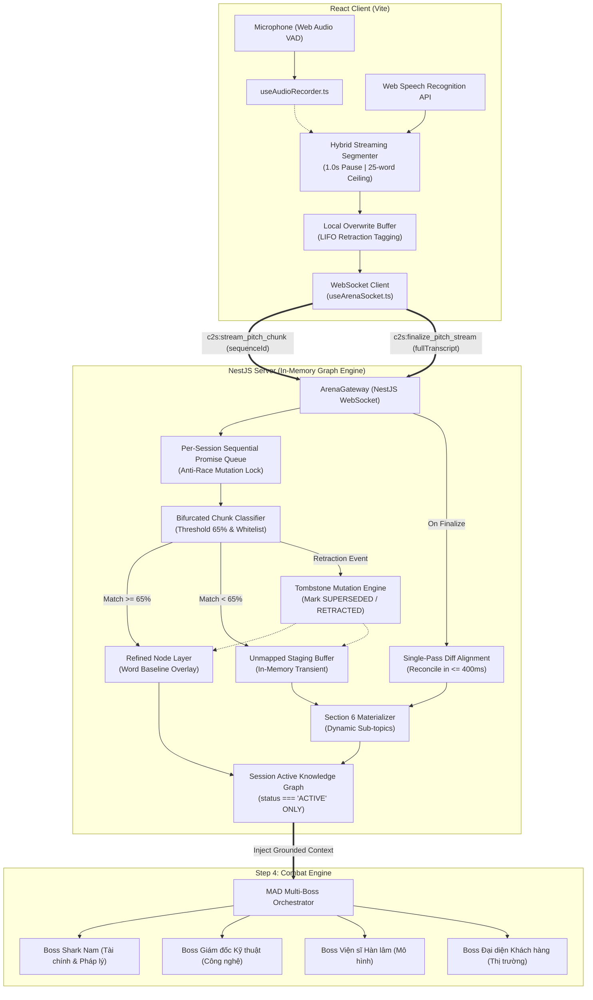
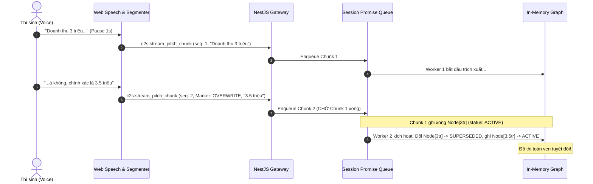

# ARCHITECTURE SPINE: SPRINT 2 — REAL-TIME STREAMING PITCH GRAPHRAG

## 1. PARADIGM & SYSTEM CONSTRAINTS

### 1.1. Core Architectural Paradigm
- **Event-Driven In-Memory Directed Acyclic Graph (DAG) with Sequential Mutation Queue**:
  - Dữ liệu lời nói dạng stream không dùng Vector Embedding tĩnh mà được mô hình hóa thành một **Đồ thị Tri thức Phi tuyến tính (In-Memory Non-linear Graph)** trên RAM tiến trình NestJS.
  - Các phát biểu thay đổi, đính chính (*retraction*) và phủ định được quản lý thông qua chuỗi **Tombstone Mutation Events** chạy tuần tự trên hàng đợi Promise Queue của từng Session.

### 1.2. Invariants & Hard Constraints
- **C-1 (Pure In-Memory / Zero Disk):** Không sử dụng cơ sở dữ liệu đồ thị bên ngoài (Neo4j, Memgraph). Toàn bộ Graph được duy trì bằng TypeScript `Map<string, PitchGraphNode>` và `adjacencyList` trên heap memory của NestJS. Tự động giải phóng khi hủy Session.
- **C-2 (Zero Build Command):** Tuyệt đối không chạy lệnh `npm run build` trong suốt quá trình phát triển và kiểm thử. Mọi kiểm tra typesafety tuân thủ qua `npx tsc --noEmit`.
- **C-3 (Monorepo Contract Sharing):** Mọi sự kiện WebSocket và cấu trúc GraphNode được định nghĩa bằng Zod tại `packages/shared/src/contracts/pitch-rag.ts` và tái sử dụng cho cả `client` và `server`.
- **C-4 (Bound Latency):** Phân loại Chunk $\le 400\text{ms}$; Khai sinh Section 6 & Chuyển cảnh sang Step 4 $\le 1.0\text{s}$.

---

## 2. KIẾN TRÚC TỔNG THỂ (System Architecture Diagram)



---

## 3. ARCHITECTURAL DECISIONS (ADs)

### AD-1: In-Memory Graph Node Structure & State Invariants
- **Binds:** `packages/shared/src/contracts/pitch-rag.ts`, `server/src/domain/rag/pitch-graph.service.ts`.
- **Prevents:** Xung đột ngữ nghĩa khi thí sinh vừa nói số liệu cũ vừa sửa số liệu mới; ngăn Boss AI hallucination hoặc hỏi những số liệu đã bị rút lại.
- **Rule:**
  - Mỗi Node trong đồ thị phải có thuộc tính `status: 'ACTIVE' | 'SUPERSEDED' | 'RETRACTED'`.
  - Chỉ các Node có `status === 'ACTIVE'` mới được nạp vào context cho Boss AI ở Bước 4.
  - Node bị đính chính chuyển thành `SUPERSEDED`, node bị hủy ý tưởng chuyển thành `RETRACTED`.

```typescript
export interface PitchGraphNode {
  id: string; // UUID v4
  sessionId: string;
  sectionId: 'SECTION_1' | 'SECTION_2' | 'SECTION_3' | 'SECTION_4' | 'SECTION_5' | 'SECTION_6_DYNAMIC';
  entityType: 'METRIC' | 'FEATURE' | 'MARKET' | 'PARTNER' | 'TIMELINE' | 'OTHER';
  key: string; // VD: 'user_count', 'revenue', 'target_market'
  value: string; // VD: '3.5 triệu đồng', 'Thị trường Lào'
  status: 'ACTIVE' | 'SUPERSEDED' | 'RETRACTED';
  source: 'WORD_BASELINE' | 'PITCH_REFINED' | 'PITCH_EXPANDED';
  supersededBy?: string; // ID của node thay thế
  sequenceId: number;
  timestamp: number;
}
```

### AD-2: Per-Session FIFO Promise Queue (Graph Locking)
- **Binds:** `server/src/domain/rag/pitch-graph-session.ts`, `server/src/websocket/arena.gateway.ts`.
- **Prevents:** Race condition giữa 2 worker khi Chunk đính chính (Chunk $N+1$) đến trước khi Chunk gốc (Chunk $N$) hoàn thành trích xuất.
- **Rule:**
  - Mỗi session khởi tạo một con trỏ hàng đợi: `mutationQueue: Promise<void> = Promise.resolve()`.
  - Mọi thao tác ghi node, sửa node hoặc tombstone đều phải xếp chuỗi:  
    `this.mutationQueue = this.mutationQueue.then(() => this.applyMutation(chunk))`.
  - Tuyệt đối không dùng Distributed Lock ngoài hay Mutex phức tạp; Event Loop của Node.js đảm bảo tuần tự 100% trong session.



### AD-3: Client-side Hybrid Streaming Segmenter
- **Binds:** `client/src/hooks/useAudioRecorder.ts`, `client/src/hooks/useArenaSocket.ts`.
- **Prevents:** Tràn buffer client khi người nói liên tục không nghỉ; ngăn spam chunk rác 1–2 từ khi thí sinh ấp úng; ngăn mất dữ liệu cuối bài pitch.
- **Rule:**
  - **Pausing Gate:** Ngắt chunk khi không có token mới trong $\ge 1.0\text{s}$ VÀ buffer $\ge 4$ từ.
  - **Hard Ceiling:** Tự động ép ngắt chunk tại ranh giới từ khi buffer chạm 25 từ (hoặc liên tục $> 6\text{s}$).
  - **Minimum Gate:** Bỏ qua việc gửi WebSocket nếu buffer $< 4$ từ (giữ lại tích lũy).
  - **Flush on Finalize:** Bấm [KẾT THÚC THUYẾT TRÌNH] lập tức gọi `flushRemainingBuffer()` đóng gói toàn bộ từ còn lại thành chunk cuối.

### AD-4: Bifurcated Routing & Business Whitelist Filter
- **Binds:** `server/src/domain/rag/chunk-classifier.service.ts`.
- **Prevents:** Rác ngôn ngữ (chào hỏi, cảm thán, than thở) lọt vào đồ thị; đảm bảo chỉ có ý tưởng kinh doanh thực sự mới được lưu trữ.
- **Rule:**
  - Đối soát cosine similarity / entity match với 5 Section Word có sẵn:
    - $\ge 65\%$ tương đồng $\rightarrow$ Tạo `RefinedNode` đè lên Section cũ.
    - $< 65\%$ tương đồng $\rightarrow$ Chuyển vào `UnmappedStagingBuffer`.
  - **Whitelist Bắt Buộc:** Chỉ các thực thể thuộc 5 nhóm sau mới được lưu trong Staging Buffer:
    1. `MARKET`: Địa bàn, quốc gia, phân khúc khách hàng mới.
    2. `FEATURE`: Tính năng công nghệ, giải pháp kỹ thuật mới.
    3. `CHANNEL_PARTNER`: Kênh phân phối, đối tác liên kết.
    4. `FINANCIAL_METRIC`: Doanh thu, định giá, chi phí, biên lợi nhuận.
    5. `TIMELINE`: Mốc tiến độ, lộ trình ra mắt.
  - Mọi câu không chứa thực thể thuộc Whitelist trên sẽ bị loại bỏ hoàn toàn.

### AD-5: Materialization of Section 6 (Khai Sinh Khối Thứ 6)
- **Binds:** `server/src/domain/rag/section6-builder.service.ts`.
- **Prevents:** Đồ thị biến động liên tục trong lúc thí sinh đang nói làm loạn chiến thuật của Boss; sinh Section 6 rỗng hoặc vô nghĩa.
- **Rule:**
  - Khối thứ 6 **CHỈ ĐƯỢC PHÉP TẠO RA** khi nhận sự kiện `c2s:finalize_pitch_stream`.
  - Nếu `UnmappedStagingBuffer` có $\ge 1$ thực thể Whitelist $\rightarrow$ Gom nhóm tạo `Section 6: DYNAMIC_EXPANDED_SCOPE` kèm tiêu đề động.
  - Nếu Staging Buffer rỗng $\rightarrow$ Đặt cờ `section6Status = 'ABSENT'`.
  - **Major Pivot Flag:** Nếu số lượng Node mới trong Staging Buffer chiếm $> 80\%$ tổng số Node trích xuất $\rightarrow$ Gắn cờ `FLAG_MAJOR_PROPOSAL_PIVOT` trong session state.

### AD-6: Single-Pass Diff Alignment on Finalize
- **Binds:** `server/src/domain/rag/diff-alignment.service.ts`.
- **Prevents:** Độ trễ chuyển cảnh kéo dài nhiều giây nếu phải replay tuần tự các chunk bị mất do mạng lag.
- **Rule:**
  - Payload `c2s:finalize_pitch_stream` mang theo `fullRawTranscript`.
  - Server thực hiện 1 lần so khớp Diff (Single-pass) giữa danh sách Node hiện có trên RAM và `fullRawTranscript` để bổ sung những thực thể còn thiếu.
  - Toàn bộ quá trình đối soát và sinh Section 6 phải kết thúc trong $\le 400\text{ms}$.

### AD-7: Adaptive Cross-Grounding Jury Prompt Strategy
- **Binds:** `server/src/adapters/llm/prompt-templates.ts`, `server/src/domain/orchestrator/mad-deliberation.service.ts`.
- **Prevents:** Boss AI quên mất bài pitch hoặc chỉ chăm chăm hỏi tài liệu Word cũ kỹ; đảm bảo tính kịch tính của sàn đấu.
- **Rule:**
  - **Ưu tiên 1 (Pitch-First):** Prompt chỉ đạo 4 Boss ưu tiên khai thác độ vênh giữa `RefinedNode` và bản Word, hoặc chất vấn tính khả thi của `Section 6`.
  - **Ưu tiên 2 (Major Pivot Attack):** Nếu có cờ `FLAG_MAJOR_PROPOSAL_PIVOT`, Boss mở màn bằng câu hỏi chất vấn việc đổi hướng đề án.
  - **Fallback Guard:** Nếu dữ liệu Pitch chưa sẵn sàng sau 1.0s, Lượt 1 dùng 100% bản Word để hỏi, Lượt 2 tự động nạp dữ liệu Pitch.

---

## 4. PUBLIC CONTRACTS & WEBSOCKET SCHEMAS (Zod Specifications)

Tệp hợp đồng công khai mới tại `packages/shared/src/contracts/pitch-rag.ts`:

```typescript
import { z } from 'zod';

// 1. C2S: Stream Chunk Lời Nói
export const StreamPitchChunkSchema = z.object({
  sessionId: z.string().uuid(),
  sequenceId: z.number().int().nonnegative(),
  timestamp: z.number(),
  text: z.string().min(1),
  isFinalChunk: z.boolean().default(false),
  detectedMarkers: z.array(z.enum([
    'OVERWRITE_DIRECT', // À không, nhầm, chính xác là
    'CANCELLATION',     // Thôi bỏ đi, bỏ qua
    'ELABORATION',      // Ý tôi là, nói cách khác
  ])).default([]),
});
export type StreamPitchChunkDto = z.infer<typeof StreamPitchChunkSchema>;

// 2. C2S: Chốt Bài Thuyết Trình
export const FinalizePitchStreamSchema = z.object({
  sessionId: z.string().uuid(),
  totalChunks: z.number().int(),
  fullRawTranscript: z.string(),
  durationSeconds: z.number(),
});
export type FinalizePitchStreamDto = z.infer<typeof FinalizePitchStreamSchema>;

// 3. S2C: Đồng Bộ Trạng Thái Đồ Thị (Visual Feedback)
export const PitchGraphSyncSchema = z.object({
  sessionId: z.string().uuid(),
  activeNodesCount: z.number().int(),
  hasSection6: z.boolean(),
  section6Title: z.string().optional(),
  isPivotDetected: z.boolean().default(false),
});
export type PitchGraphSyncDto = z.infer<typeof PitchGraphSyncSchema>;
```

---

## 5. BẢNG TIẾN ĐỘ THI CÔNG KỸ THUẬT (Technical Execution Plan)

| Ngày | Hạng mục công việc (Work Items) | Module sở hữu | Tiêu chuẩn nghiệm thu (DoD) |
| :---: | :--- | :--- | :--- |
| **D1** | Khai báo Zod contracts & DTOs | `packages/shared/src/contracts/pitch-rag.ts` | `npx tsc --noEmit` pass trên `shared` |
| **D2** | Hybrid Segmenter, Overwrite Buffer & Flush | `client/src/hooks/useAudioRecorder.ts` | Client ngắt chunk 1s, ceiling 25 từ mượt mà |
| **D3** | In-Memory Graph Engine & Promise Queue | `server/src/domain/rag/pitch-graph.service.ts` | Không race condition khi nhận chunk đính chính |
| **D4** | Unmapped Staging & Section 6 Builder | `server/src/domain/rag/section6-builder.ts` | Section 6 chỉ sinh khi nhận finalize event |
| **D5** | Single-Pass Diff Alignment & Auto-Finalize | `server/src/domain/rag/diff-alignment.ts` | Alignment chạy bù $\le 400\text{ms}$ |
| **D6** | Nạp Context Refined/Section 6 vào Prompt 4 Boss | `server/src/adapters/llm/prompt-templates.ts` | Boss đặt câu hỏi bắt bẻ điểm mới của Pitch |
| **D7** | Kiểm thử E2E tích hợp Step 3 $\rightarrow$ Step 4 | Toàn hệ thống | `npx tsc --noEmit` pass 100% cả 3 package |

---

## 6. QUY TẮC BẢO TOÀN (Preservation & Quality Assurance)
- Tuyệt đối không can thiệp làm thay đổi logic FSM và cơ chế phòng thủ 220ms Web Audio của Sprint 1.
- Mọi logic thêm mới đều nằm trong module `server/src/domain/rag/` và hook `client/src/hooks/useArenaSocket.ts`.
- Mọi thay đổi đều được kiểm tra bằng lệnh `npx tsc --noEmit` trên cả 3 package.
