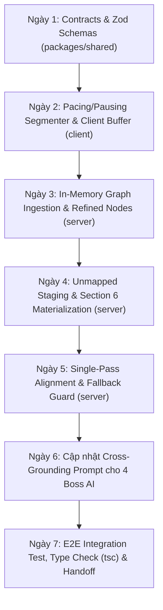

# PRD - SPRINT 2: REAL-TIME STREAMING PITCH GRAPHRAG & DYNAMIC SECTION 6

## 1. TỔNG QUAN & BỐI CẢNH (Executive Summary & Problem Statement)

### 1.1. Vấn đề thực tế (Problem Statement)
- Tại Bước 3 (Pitching), thí sinh phát biểu tự do qua micro (Web Speech API). Trong thực tế, bài nói của thí sinh luôn có các yếu tố phi tuyến tính:
  1. **Nói hớ / Đính chính (Self-Correction & Retraction):** Thí sinh buột miệng nói số liệu cũ, rồi tự sửa bằng các cụm từ bẻ lái (*"À không"*, *"Chính xác là 3.5 triệu"*). Nếu dùng Vector RAG truyền thống, cả số liệu cũ và mới đều bị vector hóa, dẫn đến việc Boss AI ở Bước 4 bị hallucination hoặc bắt bẻ mâu thuẫn ngớ ngẩn.
  2. **Phát sinh ý tưởng mới ngoài Đề án (Off-document Expansion):** Thí sinh hào hứng bổ sung thị trường mới (VD: *"dự kiến mở rộng sang Lào"*), đối tác mới, kênh bán mới không có trong 5 phần cốt lõi của file Word.
  3. **Độ trễ và rủi ro mạng:** Nếu xử lý batch sau khi nói xong thì Bước 4 phải chờ đợi; nếu streaming từng câu nhưng mạng chập chờn thì luồng nói bị gián đoạn.

### 1.2. Mục tiêu sản phẩm (Product Objectives)
- Xây dựng hệ sinh thái **Real-time Streaming Pitch GraphRAG** chạy In-Memory trong NestJS:
  - Phân đoạn âm thanh thông minh theo nhịp thở (Pacing $\le 0.8\text{s}$, Pausing $\ge 1.0\text{s}$).
  - Nhận diện đính chính đa tầng (Retraction Markers) kết hợp cơ chế Tombstone Mutation để xóa bỏ thực thể cũ, chỉ giữ lại thực thể hợp lệ (`ACTIVE`).
  - Phân luồng dữ liệu 2 nhánh: Thông tin cập nhật đè lên 5 Section cũ (`Refined Node Layer`), thông tin mới chưa rõ xếp vào `Unmapped Staging Buffer`.
  - **Khối Thứ 6 (Section 6: Dynamic Sub-topics)**: **CHỈ ĐƯỢC KHAI SINH KHI BẤM [KẾT THÚC THUYẾT TRÌNH]**, sau khi đã lọc sạch lời chào hỏi/cảm thán và thỏa mãn Whitelist thực thể kinh doanh.
  - Hội đồng Giám khảo (4 Boss) ở Bước 4 ưu tiên chất vấn xoáy sâu vào các điểm mới/đột biến của bài Pitch so với bản Word (Adaptive Cross-Grounding).

---

## 2. CHÂN DUNG NGƯỜI DÙNG & HÀNH TRÌNH (User Persona & Journey)

### 2.1. Nhân vật: Tuấn Khánh (Trưởng nhóm Sinh viên Khởi nghiệp Công nghệ)
- **Tài liệu nộp trước (Bản Word ở Bước 1):** 
  - Section 1: Nền tảng kết nối gia sư dạy kèm trực tuyến.
  - Section 3 (Tài chính & Mô hình): *"Chưa thương mại hóa, có 50 người dùng thử nội bộ, doanh thu 0 VNĐ"*.
- **Diễn biến tại Bước 3 (Pitching trên sàn đấu Arena):**
  - Đứng trước mic, Khánh hào hứng nói: *"Thưa ban giám khảo, tháng vừa rồi nhóm đã nâng lên 200 người dùng thật và thu được 3 triệu đồng doanh thu đầu tiên... À không, nhầm, chính xác theo báo cáo kế toán hôm qua là 3.5 triệu đồng. Ngoài ra, nhóm cũng dự định sang năm sẽ mở rộng mô hình sang thị trường Lào"*.
- **Phản ứng của Hệ thống:**
  1. Nhận diện nhịp nghỉ 1.2s sau chữ *"đầu tiên"* $\rightarrow$ Đóng gói Chunk 1 (`200 người dùng, 3 triệu doanh thu`).
  2. Nhận diện Marker *"À không, nhầm, chính xác theo báo cáo... là 3.5 triệu"* ở Chunk 2 $\rightarrow$ Phát sinh `Tombstone Mutation Event`, đổi trạng thái node `3 triệu` thành `SUPERSEDED`, ghi nhận node `3.5 triệu` là `ACTIVE`.
  3. Phân luồng: `200 users` và `3.5 triệu` khớp $> 65\%$ với Section 3 $\rightarrow$ Ghi vào `Refined Node Layer` của Section 3.
  4. Nhận diện ý tưởng *"mở rộng sang thị trường Lào"* có độ tương đồng $< 25\%$ với 5 Section cũ $\rightarrow$ Đẩy tạm vào `Unmapped Staging Buffer`.
- **Khoảnh khắc bấm [KẾT THÚC THUYẾT TRÌNH]:**
  - Hệ thống xả nốt buffer cuối, kích hoạt Single-Pass Diff Alignment trong 350ms.
  - Kiểm tra `Unmapped Staging Buffer`: Lọc bỏ lời chào hỏi, xác định thực thể `Thị trường Lào` hợp lệ theo Business Whitelist $\rightarrow$ **Chính thức sinh ra `Section 6: DYNAMIC_EXPANDED_SCOPE`**.
- **Chuyển cảnh sang Bước 4 (Combat):**
  - Shark Nam mở màn sắc lẹm: *"Trong bài pitch bạn hào hứng khoe có 3.5 triệu doanh thu và tính mở rộng sang Lào, nhưng toàn bộ đề án Word nộp cho tôi không có một dòng nào dự trù ngân sách cho việc xin giấy phép tại Lào. Đội ngũ sinh viên các bạn định xoay xở pháp lý và vốn thế nào?"*.
  - Khánh giật mình nhưng thán phục vì AI thực sự lắng nghe từng lời đính chính và ý tưởng mới nhất của mình.

---

## 3. DANH SÁCH YÊU CẦU CHỨC NĂNG (Functional Requirements - FRs)

### FR-01: Pacing & Pausing Streaming Segmenter (Nâng cấp)
- **Mục tiêu:** Bắt trọn vẹn đơn vị ngữ nghĩa (Semantic Clause) theo nhịp thở tự nhiên của người nói.
- **Quy tắc phân đoạn:**
  1. **Khoảng lặng chuẩn (Pausing Gate):** Khi không có token mới trong $\ge 1.0\text{s}$ VÀ buffer tích lũy $\ge 4$ từ $\rightarrow$ Đóng gói payload gửi qua WebSocket (`c2s:stream_pitch_chunk`).
  2. **Trần an toàn (Hard Ceiling):** Nếu thí sinh nói một hơi không nghỉ quá 25 từ (hoặc quá 6 giây) $\rightarrow$ Tự động ép ngắt chunk tại ranh giới từ gần nhất để tránh phình to buffer client và chống trễ trích xuất trên server.
  3. **Bộ lọc tối thiểu (Minimum Gate):** Không gửi chunk $< 4$ từ (hoặc $< 15$ ký tự) nhằm ngăn chặn spam worker do thí sinh ấp úng (*"Dạ... em... thì..."*).
  4. **Bảo toàn thứ tự (Sequence Integrity):** Mỗi payload `c2s:stream_pitch_chunk` bắt buộc phải kèm `sequenceId: number` tăng dần và `timestamp: number` để server tự sắp xếp lại đúng trình tự nếu mạng chập chờn.
  5. **Xả đệm dứt điểm (Flush on Finalize):** Khi bấm `[KẾT THÚC THUYẾT TRÌNH]`, client tự động chạy `flushRemainingBuffer()`, đóng gói số từ còn sót lại thành chunk cuối cùng trước khi đóng luồng.

### FR-02: Retraction Detection & Semantic Mutation Engine (Nâng cấp)
- **Mục tiêu:** Nhận diện ý đồ đính chính/sửa sai của thí sinh, loại bỏ xung đột dữ liệu đồ thị.
- **Phân loại Retraction Markers theo 3 cấp độ:**
  1. **Direct Overwrite Markers (Xóa & Thay thế):** `"À không"`, `"Nhầm"`, `"Chính xác là"`, `"Đính chính lại"`.  
     $\rightarrow$ Đánh dấu thực thể liền kề trước đó thành `SUPERSEDED`, ghi nhận thực thể mới liền sau là `ACTIVE`.
  2. **Pure Cancellation Markers (Hủy bỏ ý tưởng):** `"Thôi bỏ đi"`, `"Bỏ qua phần này"`, `"Chưa tính tới"`.  
     $\rightarrow$ Gắn nhãn `RETRACTED`, triệt tiêu hoàn toàn, không tạo node thay thế và không đưa vào Section 6.
  3. **Elaboration Markers (Làm rõ - Không xóa):** `"Ý tôi là"`, `"Nói cách khác"`, `"Để nói rõ hơn"`.  
     $\rightarrow$ Giữ nguyên cả hai thực thể, thiết lập quan hệ cạnh đồ thị `CLARIFIES` / `EXPANDS_ON`.
- **Cơ chế Cross-Chunk & Cascading Retraction:**
  - Hỗ trợ sửa đổi thực thể thuộc chunk đã gửi trước đó thông qua `Tombstone Mutation Event` gửi lên server đối soát theo `sequenceId`.
  - Hàng đợi LIFO (Last-In-First-Out) xử lý đính chính liên hoàn (sửa đi sửa lại 3 lần) mà không phá vỡ tính toàn vẹn của đồ thị.
- **Nguyên tắc truy vấn của Boss:** Lớp Question Generator của Boss AI chỉ truy vấn các Node có `status === 'ACTIVE'`, miễn nhiễm 100% với các số liệu sai đã bị thí sinh đính chính.

### FR-03: Optimistic Real-time with Single-Pass Diff Alignment
- **Mục tiêu:** Luồng thuyết trình của thí sinh mượt mà tuyệt đối, tự phục hồi lỗi truyền nhận mà không làm đơ giao diện.
- **Quy tắc xử lý:**
  1. **Optimistic Stream:** Client gửi chunk và cập nhật UI sóng âm/transcript ngay lập tức, không chờ server phản hồi ACK.
  2. **Fault-tolerant Queue:** Nếu chunk gửi lên server bị timeout hoặc mất mạng tạm thời $\rightarrow$ Client gắn cờ `FAILED_RETRY_CHUNK` và lưu vào hàng đợi nội bộ.
  3. **Single-Pass Diff Alignment:** Khi thí sinh bấm `[KẾT THÚC THUYẾT TRÌNH]` (hoặc hết 2 phút), client gửi payload `c2s:finalize_pitch_stream` kèm theo toàn bộ `fullRawTranscript`. Server thực hiện đúng 1 lần đối soát toàn diện (Diff Alignment) trong $\le 400\text{ms}$ để bù đắp các lỗ hổng thực thể bị mất.
  4. **Server Auto-Finalize Safeguard:** Nếu client mất mạng hoàn toàn và quá thời gian pitch (2 phút + 5s ân hạn), server tự động chốt đồ thị theo các chunk đã nhận và chuyển trạng thái sang Bước 4, chống treo session.

### FR-04: Bifurcated Graph Ingestion & Entity Whitelisting
- **Mục tiêu:** Phân loại thông tin bài nói theo 2 nhánh độc lập ngay khi nhận chunk.
- **Quy tắc phân loại:**
  1. **Nhánh A (Refined Node Layer - Tương đồng $\ge 65\%$):**  
     - Đối soát với 5 Section Word có sẵn (Vấn đề, Giải pháp, Mô hình kinh doanh, Thị trường & Đối thủ, Đội ngũ).  
     - Tạo `RefinedNode` đè lên thông tin cũ (ghi rõ: `wordBaseline`, `pitchRefinement`, `deltaRatio`).
  2. **Nhánh B (Unmapped Staging Buffer - Tương đồng $< 65\%$):**  
     - Tạm lưu trữ tại buffer trung gian trên RAM.  
     - **Business Whitelist Filter:** Chỉ giữ lại các thông tin chứa thực thể hợp lệ:
       - `MARKET_EXPANSION` (Địa bàn/Quốc gia mới)
       - `NEW_FEATURE` (Tính năng công nghệ đột phá)
       - `CHANNEL_PARTNER` (Kênh bán/Đối tác chiến lược)
       - `FINANCIAL_METRIC` (Chỉ số tài chính/Định giá mới)
     - Lọc bỏ triệt để các câu rác: chào hỏi, giới thiệu bản thân, cảm thán, than thở.

### FR-05: Materialization of Section 6 (Khai Sinh Khối Thứ 6) & Pivot Flagging
- **Mục tiêu:** Khối thứ 6 chỉ được sinh ra đúng thời điểm nộp bài và chỉ khi có giá trị kinh doanh thực chất.
- **Quy tắc kích hoạt:**
  1. **Thời điểm khai sinh:** Đúng lúc nhận sự kiện `finalize_pitch_stream` từ client. Tuyệt đối không tạo Khối 6 khi đang pitch dở dang.
  2. **Điều kiện tồn tại:**
     - Nếu `Unmapped Staging Buffer` sau khi lọc Whitelist có $\ge 1$ cụm thực thể hợp lệ $\rightarrow$ Khởi tạo `Section 6: DYNAMIC_EXPANDED_SCOPE` với tiêu đề động (VD: *"Kế hoạch thâm nhập thị trường Lào"*).
     - Nếu không có ý tưởng mới nào đáng kể $\rightarrow$ Section 6 mang trạng thái `ABSENT` (không hiển thị, không làm rối cấu trúc 5 section).
  3. **Cờ Đổi hướng đề án (Major Pivot Detection):**  
     - Nếu $> 80\%$ nội dung bài pitch rơi vào Unmapped Staging Buffer và mâu thuẫn trực tiếp với đề án Word $\rightarrow$ Hệ thống tự động gắn cờ `FLAG_MAJOR_PROPOSAL_PIVOT`. Boss ở Bước 4 sẽ mở màn bằng câu hỏi chất vấn việc "nói một đằng, nộp bài một nẻo".

### FR-06: Adaptive Cross-Grounding Jury Strategy
- **Mục tiêu:** 4 Boss Giám khảo ở Bước 4 phối hợp chất vấn thông minh dựa trên sự kết hợp giữa bản Word và bài Pitch.
- **Thứ tự ưu tiên chất vấn:**
  1. **Ưu tiên 1 (Pitch-First Confrontation):** Boss tập trung khai thác các điểm mâu thuẫn hoặc điểm số liệu mới tại `Refined Nodes` và `Section 6`.
  2. **Ưu tiên 2 (Word Baseline):** Nếu bài pitch chỉ nói chung chung hoặc không có Section 6, Boss quay về chất vấn các điểm mù (Blindspots) cốt lõi trong tài liệu Word.
  3. **Graceful Fallback:** Trong trường hợp hiếm hoi tiến trình Alignment của Pitch bị trễ quá 1.0s khi vừa bước vào Bước 4 $\rightarrow$ Lượt 1 (Turn 1) Boss lập tức dùng dữ liệu Word để hỏi. Từ Lượt 2 trở đi tự động nạp dữ liệu Pitch đã xử lý xong.

---

## 4. YÊU CẦU PHI CHỨC NĂNG (Non-Functional Requirements - NFRs)

- **NFR-01 (Độ trễ xử lý Chunk):** Thời gian phân loại ngữ nghĩa và cập nhật node đồ thị trên server $\le 400\text{ms}$ mỗi chunk.
- **NFR-02 (Thời gian Khai sinh Khối 6 & Chuyển cảnh):** Tổng thời gian Single-Pass Alignment, lọc Whitelist, tạo Khối 6 và chuyển trạng thái FSM sang Bước 4 $\le 1.0\text{s}$ kể từ khi bấm nộp bài.
- **NFR-03 (Bộ nhớ thuần In-Memory):** Toàn bộ cấu trúc GraphRAG (Node, Edge, Tombstones, Staging Buffer) lưu trữ hoàn toàn trên RAM của tiến trình NestJS, giải phóng triệt để khi kết thúc session (Zero Disk Storage, bảo mật dữ liệu sinh viên).
- **NFR-04 (Type Safety & No Build Command):** Toàn bộ Schemas và WebSocket Events được định nghĩa bằng Zod trong `packages/shared`, kiểm tra tính toàn vẹn bằng `npx tsc --noEmit` trên cả 3 package (`shared`, `server`, `client`). **TUYỆT ĐỐI KHÔNG CHẠY `npm run build`**.

---

## 5. BẢN ĐỒ GIAO THỨC DỮ LIỆU (WebSocket Contracts - Zod Specs)

Các hợp đồng dữ liệu mới sẽ được triển khai tại `packages/shared/src/contracts/pitch-rag.ts`:

```typescript
// 1. Client stream chunk lên Server
export const StreamPitchChunkSchema = z.object({
  sessionId: z.string().uuid(),
  sequenceId: z.number().int().nonnegative(),
  timestamp: z.number(),
  text: z.string().min(1),
  isFinalChunk: z.boolean().default(false),
});

// 2. Client chốt bài thuyết trình
export const FinalizePitchStreamSchema = z.object({
  sessionId: z.string().uuid(),
  totalChunks: z.number().int(),
  fullRawTranscript: z.string(),
  durationSeconds: z.number(),
});

// 3. Cấu trúc Node trong GraphRAG
export const PitchGraphNodeSchema = z.object({
  id: z.string().uuid(),
  sectionId: z.enum(['SECTION_1', 'SECTION_2', 'SECTION_3', 'SECTION_4', 'SECTION_5', 'SECTION_6_DYNAMIC']),
  entityType: z.enum(['METRIC', 'FEATURE', 'MARKET', 'PARTNER', 'TIMELINE', 'OTHER']),
  value: z.string(),
  status: z.enum(['ACTIVE', 'SUPERSEDED', 'RETRACTED']),
  source: z.enum(['WORD_BASELINE', 'PITCH_REFINED', 'PITCH_EXPANDED']),
  confidence: z.number().min(0).max(1),
});
```

---

## 6. KẾ HOẠCH TRIỂN KHAI 7 NGÀY (Sprint 2 Roadmap)



- **Ngày 1:** Định nghĩa WebSocket events và Zod schemas trong `packages/shared`.
- **Ngày 2:** Cập nhật `useAudioRecorder.ts` và `useArenaSocket.ts` với cơ chế Pacing/Pausing, Hard Ceiling và Flush on Finalize.
- **Ngày 3:** Xây dựng `PitchGraphService` và `MutationEngine` trên NestJS server để quản lý Refined Nodes và Tombstones.
- **Ngày 4:** Xây dựng `UnmappedStagingBuffer` và module tự động sinh `Section 6` khi nhận event finalize.
- **Ngày 5:** Hoàn thiện `SinglePassDiffAlignment` và cơ chế phòng vệ Auto-Finalize Timer.
- **Ngày 6:** Tích hợp `Section 6` và `Refined Nodes` vào context prompt của 4 Boss tại `prompt-templates.ts`.
- **Ngày 7:** Kiểm tra E2E luồng Step 3 $\rightarrow$ Step 4, xác minh `npx tsc --noEmit` pass 100% không có lỗi.

---

## 7. TIÊU CHÍ NGHIỆM THU (Acceptance Sign-off)

1. [x] **Ngắt câu tự nhiên:** Thí sinh nói có nhịp nghỉ $\ge 1.0\text{s}$, chunk tự động gửi lên server mượt mà; nói dài quá 25 từ tự động ngắt an toàn.
2. [x] **Xóa số liệu cũ khi đính chính:** Thí sinh nói: *"3 triệu... à không, 3.5 triệu"*, hệ thống chỉ lưu `3.5 triệu` ở trạng thái `ACTIVE`, loại bỏ `3 triệu`.
3. [x] **Sinh Khối Thứ 6 chính xác:** Khi bấm nộp bài thuyết trình, nếu có ý tưởng mở rộng hợp lệ thì tạo `Section 6`; nếu chỉ chào hỏi hoặc than thở thì không tạo Khối 6.
4. [x] **Boss AI hỏi đúng trọng tâm:** Boss ở Bước 4 bắt bẻ được ít nhất 1 điểm chênh lệch giữa bài nói và tài liệu Word (hoặc hỏi sâu vào Khối 6).
5. [x] **Tuân thủ quy tắc Monorepo:** Chạy `npx tsc --noEmit` pass 100% trên cả 3 package (`shared`, `server`, `client`); tuyệt đối không chạy lệnh build.
