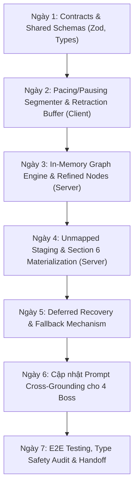

# PRD: REALTIME STREAMING PITCH GRAPHRAG & CROSS-GROUNDING JURY
## Sprint 2 (1 Tuần) • PITCH·ARENA STUDIO

| Thuộc Tính | Nội Dung Chi Tiết |
| :--- | :--- |
| **Dự Án** | PITCH·ARENA STUDIO |
| **Tài Liệu** | Product Requirements Document (PRD) — Sprint 2 |
| **Thời Gian Thực Hiện** | 1 Tuần (7 Ngày) |
| **Trạng Thái** | **FINALIZED DRAFT / READY FOR DEV** |
| **Tác Giả** | John (Product Manager) phối hợp cùng Hệ thống BMad |

---

## 1. TỔNG QUAN & TẦM NHÌN SẢN PHẨM (Vision & Core Intent)

### 1.1. Vấn Đề Thực Tế (Problem Statement)
Ở Sprint 1, PITCH·ARENA đã bóc tách tài liệu Word tĩnh thành 5 phân mục chuyên môn. Tuy nhiên:
1. **Thiếu khả năng thu nạp bài nói thực tế:** Khi thí sinh thuyết trình ở Bước 3 (2-3 phút), họ công bố rất nhiều số liệu thực tế, giải thích kiến trúc hoặc kế hoạch cập nhật mới. Nhưng RAG hiện tại không thu thập được, dẫn đến việc Giám khảo ở Bước 4 chỉ hỏi lại nội dung trong Word và coi các số liệu mới của thí sinh là "vô căn cứ".
2. **Bẫy nói nhầm & đính chính (Speech Retraction):** Thí sinh khi run thường nói vấp: *"Số lượng khách hàng là 50... à không, ý tôi là 250 người dùng"*. Nếu RAG thu thập mù quáng sẽ ghi nhận cả số 50 lẫn 250, gây xung đột thông tin và làm Giám khảo ảo giác.
3. **Mất chữ do mạng giật (Network & Chunk Drops):** Các chunk âm thanh gửi qua WebSocket nếu bị rớt mạng giữa chừng sẽ làm bài nói bị đứt đoạn, mất ngữ cảnh.

### 1.2. Tuyên Ngôn Giải Pháp (The Solution Vision)
Xây dựng kiến trúc **Real-time Spoken GraphRAG** chạy song song trong lúc thuyết trình:
- **Cắt nhịp tự nhiên $\ge 1.0\text{s}$** (Pacing & Pausing).
- **Phát hiện từ khóa bẻ lái (Retraction Detection)** kèm cơ chế Overwrite Buffer ("Xóa băng & Thay thế").
- **Ủ tạm ý tưởng mới trong Staging Buffer** và **chỉ khai sinh Khối Thứ 6 (`Section 6: Dynamic Sub-topics`) khi người dùng ấn nút nộp bài**.
- **Cơ chế phục hồi ngầm (Deferred Recovery)** bù đắp 100% các chunk lỗi trong 500ms chuyển cảnh.
- **Hội đồng Giám khảo ưu tiên phản biện bài Pitch**, nếu RAG đang phục hồi thì tự động fallback hỏi Đề án Word mượt mà.

---

## 2. CHÂN DUNG NGƯỜI DÙNG & USER JOURNEY

### 2.1. Protagonist: Tuấn Khánh (Trưởng nhóm Sinh viên Khởi nghiệp)
- **Tình huống:** Khánh nộp bản Word ghi nhận *"Chưa thương mại hóa, có 50 người test nội bộ"*. 
- **Diễn biến tại Bước 3:** Đứng trước mic, Khánh hào hứng nói: *"Thưa ban giám khảo, tháng vừa rồi nhóm đã nâng lên 200 người dùng thật và thu được 3 triệu đồng doanh thu đầu tiên. À không, chính xác là 3.5 triệu đồng. Ngoài ra nhóm cũng dự định sang năm sẽ mở rộng mô hình sang thị trường Lào"*.
- **Hành vi hệ thống:**
  - Nhận diện `À không, chính xác là 3.5 triệu` $\rightarrow$ Xóa con số 3 triệu, ghi nhận `3.5 triệu` vào Whitelist.
  - Nhận diện `200 người dùng thật & 3.5 triệu` $\rightarrow$ Cập nhật vào `Refined Node` của Mục 3 (Mô hình kinh doanh).
  - Nhận diện `Mở rộng sang thị trường Lào` (ngoài phạm vi 5 mục) $\rightarrow$ Đẩy vào `Unmapped Staging Buffer`.
- **Khi Khánh bấm [KẾT THÚC THUYẾT TRÌNH]:**
  - Hệ thống gom `thị trường Lào` tạo thành **Khối Thứ 6: Kế Hoạch Mở Rộng Địa Lý**.
  - Sang Bước 4, Shark Nam lập tức chất vấn: *"Trong bài pitch bạn có nhắc đến kế hoạch sang thị trường Lào và đạt 3.5 triệu doanh thu, nhưng đề án Word không hề có dự trù ngân sách cho việc này. Bạn giải thích thế nào?"*.
  - Khánh thở phào vì Giám khảo lắng nghe thực sự và đánh giá đúng những gì mình vừa trình bày.

---

## 3. DANH SÁCH YÊU CẦU CHỨC NĂNG (Functional Requirements - FRs)

### FR-01: Pacing & Pausing Streaming Segmenter
- **Mô tả:** Bộ ngắt chunk âm thanh thông minh dựa trên nhịp thở của người nói.
- **Quy tắc:**
  - Khi khoảng lặng giữa các từ $\ge 1.0\text{s}$ $\rightarrow$ Kích hoạt đóng gói chunk văn bản hoàn chỉnh và gửi qua WebSocket (`c2s:stream_pitch_chunk`).
  - Khi đang nói liên tục (Pacing $\le 0.8\text{s}$) $\rightarrow$ Tích lũy vào Sliding Window (15 - 25 từ) để giữ trọn vẹn mệnh đề ngữ nghĩa.

### FR-02: Retraction Detection & Overwrite Buffer ("Xóa Băng & Thay Thế")
- **Mô tả:** Nhận diện các điểm đính chính ngữ nghĩa của thí sinh để tránh xung đột dữ liệu đồ thị.
- **Từ khóa bẻ lái nhận diện (Retraction Markers):**
  - `"Nhưng mà"`, `"Ý tôi là"`, `"Nói cách khác"`, `"Để nói rõ hơn"`, `"Thôi bỏ đi"`, `"Đính chính lại"`, `"Chính xác là"`.
- **Cơ chế xử lý:** Khi gặp marker, bộ đệm Overwrite Buffer lập tức thu hồi thực thể vừa phát hiện trước đó, thay thế bằng thực thể phát âm liền sau marker và đánh dấu node cũ là `SUPERSEDED`.

### FR-03: Optimistic Real-time with Deferred Recovery
- **Mô tả:** Xử lý dòng dữ liệu lạc quan, không chặn luồng nói của thí sinh khi gặp lỗi mạng.
- **Quy tắc:**
  - Nếu chunk gửi lên server bị timeout hoặc lỗi worker $\rightarrow$ Client gắn cờ `FAILED_RETRY_CHUNK` và lưu vào hàng đợi cục bộ.
  - Khi thí sinh ấn `[KẾT THÚC THUYẾT TRÌNH]` (hoặc hết 2 phút) $\rightarrow$ Client gửi gói tổng kết `c2s:finalize_pitch_stream`. Server lập tức kích hoạt tiến trình chạy bù ngầm (Background Recovery) trong 500ms để vá trọn vẹn toàn bộ transcript.

### FR-04: Bifurcated Graph Ingestion (Refined Node vs. Unmapped Staging)
- **Mô tả:** Phân loại thông tin bài nói theo 2 nhánh độc lập:
  - **Nhánh A (Trùng khớp 5 Section cũ với độ tương đồng $\ge 65\%$):** Ghi đè vào lớp `Refined Node Layer` tương ứng (Ví dụ: Số lượng người dùng mới đè lên số lượng cũ trong đề án).
  - **Nhánh B (Ngoại lai / Ý tưởng mới với độ tương đồng $< 65\%$):** Đẩy vào vùng đệm chờ `Unmapped Staging Buffer`. Tuyệt đối không tạo Node rác trong lúc đang nói.

### FR-05: Materialization of Section 6 (Khai Sinh Khối Thứ 6)
- **Mô tả:** Khối thứ 6 chỉ được chính thức tạo ra tại thời điểm bấm nộp bài thuyết trình.
- **Quy tắc:**
  - Quét `Unmapped Staging Buffer`: Lọc bỏ lời chào hỏi xã giao (`"Cảm ơn quý thầy cô..."`, `"Xin chào ban giám khảo..."`).
  - Gom các câu có cùng chủ đề lại. Nếu có nội dung giá trị thực chất $\rightarrow$ Tạo `Section 6: DYNAMIC_EXPANDED_SCOPE` (Khối mở rộng phát sinh).
  - Nếu không có ý tưởng mới nào đáng kể $\rightarrow$ Không tạo Khối 6, giữ nguyên 5 Section đã refine.

### FR-06: Adaptive Cross-Grounding Jury Strategy
- **Mô tả:** Quy tắc chất vấn ưu tiên của 4 Boss Giám khảo ở Bước 4.
- **Thứ tự ưu tiên:**
  1. **Ưu tiên 1 (Pitch-First):** Boss chất vấn trực tiếp các điểm mới tại `Section 6` hoặc các `Refined Nodes` có sự chênh lệch so với bản Word.
  2. **Cơ chế Fallback (Graceful Degradation):** Nếu tiến trình Deferred Recovery của bài Pitch chưa hoàn tất khi vừa bước vào Bước 4 $\rightarrow$ Lượt 1 (Turn 1) Boss lập tức dùng dữ liệu Word để hỏi nền tảng. Khi Recovery hoàn tất, từ Lượt 2 trở đi Boss chuyển hướng sang hỏi bài Pitch.

---

## 4. YÊU CẦU PHI CHỨC NĂNG (Non-Functional Requirements - NFRs)

- **NFR-01 (Độ trễ):** Thời gian phân loại và xử lý chunk lời nói $\le 450\text{ms}$.
- **NFR-02 (Thời gian chuyển cảnh):** Thời gian tổng hợp Staging Buffer và sinh Khối 6 khi bấm Nộp bài $\le 1.2\text{s}$.
- **NFR-03 (Bộ nhớ In-Memory):** Toàn bộ Đồ thị tri thức lưu trên RAM của tiến trình NestJS, giải phóng hoàn toàn khi kết thúc session (Zero Disk Storage).
- **NFR-04 (Type Safety & No Build Command):** Toàn bộ Contracts được định nghĩa bằng Zod trong `packages/shared`, kiểm tra bằng `npx tsc --noEmit`, tuân thủ nghiêm ngặt quy tắc không chạy `npm run build`.

---

## 5. KẾ HOẠCH TRIỂN KHAI 7 NGÀY (Sprint 2 Roadmap)

---

## 6. TIÊU CHÍ NGHIỆM THU (Acceptance Sign-off)

1. Thí sinh nói ngắt quãng $\ge 1.0\text{s}$, chunk được gửi tức thì lên server không bị giật lag.
2. Thí sinh nói đính chính ("à không, ý tôi là X"), hệ thống chỉ lưu giá trị X, loại bỏ giá trị cũ.
3. Khi thí sinh bấm [Nộp bài Pitch], Khối thứ 6 tự động sinh ra nếu có ý mới; không sinh ra nếu chỉ chào hỏi.
4. Boss Giám khảo ở Bước 4 đặt được ít nhất 1 câu hỏi bắt bẻ sự khác nhau giữa Đề án và Lời nói bài Pitch.
5. `npx tsc --noEmit` pass 100% trên cả 3 package (`shared`, `server`, `client`).
